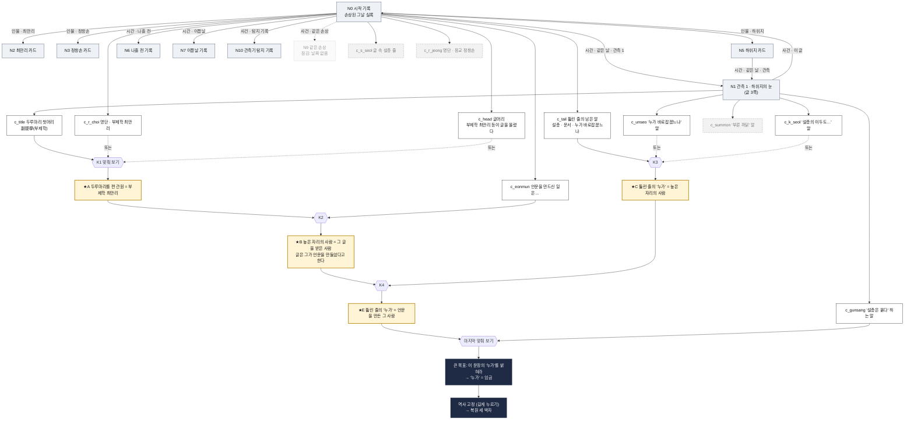

# DESIGN v6 — 기록을 따라가 그날을 고정한다 (개정 2: 큰 목표 · 자유 맞춰 보기 · 현대어 + 원문 보기 · 글 전용)

> 상태: **설계안, 목업 승인 전에는 구현하지 않는다**(`UI_STYLE_GUIDE.md` §0).
> 방향(사용자 결정, 2026-10-19): **스토리 중심, 퍼즐은 쉽게.**
> 개정 2(사용자 피드백 반영):
> ① **큰 목표만 보인다.** 화면에는 에피소드의 큰 목표 하나만 뜬다(Ep0 「이 문장의 '누가'를 밝혀라」). 중간 퍼즐(옛 P1·P2)을 따로 목표로 띄우지 않는다.
> ② **자유 맞춰 보기.** 플레이어는 언제든 주머니에서 단서 n개를 골라 「맞춰 보기」를 누른다. 맞는 묶음이면 **결론 단서**가 나와 주머니에 들어간다. 틀린 묶음이면 짧은 「왜 아닌지」가 나온다(답 낱말 없음). 큰 목표도 같은 「맞춰 보기」로 풀린다.
> ③ **문장은 현대어로, 「원문 보기」 지원.** 모든 사료 문장은 우리가 쓴 현대어 풀이(`reconstructed`)로 보이고, 「원문 보기」를 열면 검증된 국역 그대로와 한문 원문(확보된 것만), 출처가 보인다. 판정과 역사 고정은 검증된 문장에 맞춘다.
> ④ **이미지 없음(글 전용).** 게임은 그림을 보여 주지 않는다. 장면 컷·픽셀 아트·씬 그림은 없다. 기록은 글 카드이고, 단서는 글에서 나온다. 관측도 「한 사람의 눈으로 쓴 글」이다.
> 유지: 세계(`DESIGN_V3.md` §0.1 — 역사 소실·관측기·역사 고정), 실록청·대조관 07·한 선임·오 실장, provenance 세 층위, 검증 사료(`HISTORICAL_SOURCES.md` §11·§13), 조용한 현실 재기록(`DESIGN_V5.md` §14.7), 세로 전용.
> 판결 반영: `docs/court/JUDGEMENT.md`(찍기·답 노출·숨은 경로·미끼 피드백 오류), `docs/court-uiux/VERDICT.md`(겹침·화면 밖 피드백). 그림 관련 판결(정수 배율·임금 얼굴)은 그림이 없어져 해당 없음.
> 스포일러(`scenario-private/`)는 인용하지 않는다.

---

## 0. 한 장 요약

| 항목 | 결정 |
|---|---|
| 한 줄 피치 | 뚫린 실록 한 꼭지에서 출발해 이어진 기록을 따라 읽고, 단서를 맞춰 보며 그날의 빈칸을 밝혀 다시 고정한다 |
| 동사 4 | **따라가기**(연결 칩을 눌러 다음 기록으로) · **모으기**(글의 밑줄을 눌러 주머니에) · **맞춰 보기**(아무 때나 단서 n개를 골라 맞춰 본다 → 결론 또는 왜 아닌지) · **역사 고정**(큰 목표가 풀리면 길게 눌러 고정) |
| 보이는 목표 | **큰 목표 하나뿐.** 중간 물음은 엔진 안에만 있다(숨은 물음, §3.2). 진행은 결론 단서와, 목표 문장 아래에 붙는 「지금까지 밝힌 것」 줄로만 보인다 |
| 기록 | 모두 글 카드: 실록(현대어 풀이 + 원문 보기) · 인물 카드(백과 사실) · 관측(한 사람의 눈으로 쓴 글 3~5쪽) · 현재 문서(관측기 로그, 허구) · 결론 |
| 연결 | **위치 · 시간 · 인물 · 사건**. 칩 하나가 기록 하나로 간다 |
| 판정 | 데이터. 단서 = 사실 묶음, 맞춰 보기 = 사실 잇기. UI에 정답이 없다 |
| 실패 | 벌 없음. 「왜 아닌지」 한두 문장, 고른 단서를 짧은 이름으로 들어 말하고 정답 낱말은 쓰지 않는다 |
| 난이도 | 쉽다. Ep0 단서 11개 · 결론 4개 · n = 2 고정. 무작위 맞춰 보기가 새 결론을 낼 확률 ≤ 1/5(Ep0 최대 2/21) |
| 보상 | 결론 → 사람 이름이 바뀐다 → 큰 목표 → 역사 고정 → 무너진 단락이 돌아오고, 현실과 대화 기록이 조용히 다시 쓰인다 |
| 분량 | Ep0 「하룻밤」 약 10분 · Ep1 「한 사관의 흔적」 약 25분 |
| UI 용어 | 기록 · 연결 · 단서 · 결론 · 목표 · 맞춰 보기 · 원문 보기 · 관측 · 역사 고정 · 빈자리. SF 용어는 **관측기** 하나 |

---

## 0.1 퍼즐 관계도 — Ep0

시작 기록에서 연결(위치·시간·인물·사건)로 이어진 기록, 각 기록이 주는 단서, 맞춰 보기 묶음 → 결론, 마지막 묶음 → 큰 목표 → 역사 고정. **점선 회색 = 미끼 단서**(맞는 묶음에 들지 않는다), 금색 = 결론. §5.4 조합표와 같다.



---

## 1. 핵심 루프

```
이야기 장면 → (큰 목표 하나가 늘 위에) → 연결을 따라 기록을 읽는다 → 밑줄을 모은다
      ↑                                                            ↓
현실이 바뀐다 ← 역사 고정 ← 큰 목표 풀림 ← 결론이 주머니에 ← 맞춰 보기(아무 때나) ⇄ 왜 아닌지
```

| 단계 | 플레이어가 하는 것 | 화면 | 규칙 |
|---|---|---|---|
| 1 이야기 장면 | 메신저 한두 줄, 07 독백 | 메신저 · 기록 | 장면은 새 기록이나 새 연결을 연다. 목표를 새로 띄우지 않는다 |
| 2 큰 목표 | 목표 띠를 읽는다 | 모든 화면 위 띠 | 에피소드에 하나. 질문·명령 꼴, 화면에 보이는 대상을 가리키고 답 낱말이 없다 |
| 3 따라가기 | 연결 칩을 누른다 | 기록 | 칩마다 종류 낱말. 잠긴 칩은 까닭을 적는다 |
| 4 모으기 | 밑줄을 누르면 주머니로 날아간다 | 기록 | 기록 머리에 「단서 1/3」(숨은 단서 없음) |
| 5 맞춰 보기 | 주머니에서 n개를 골라 「맞춰 보기」 | 주머니 시트 | 언제든 할 수 있다. n칸이 다 차야 켜진다 |
| 6a 왜 아닌지 | 한두 문장을 읽고 바꾼다 | 같은 시트, n칸 바로 아래 | 고른 칩 하나가 흔들린다. 벌 없음 |
| 6b 결론 | 결론 단서가 도장처럼 찍혀 주머니에 들어간다 | 같은 시트 → 기록 | 사람 부르는 말이 바뀐다(「두루마리를 편 관원」→「최만리」). 큰 목표 대상에 관한 결론은 목표 문장 아래 「지금까지 밝힌 것」에 붙는다 |
| 6c 큰 목표 | 맞춰 보기 결과가 큰 목표를 채운다 | 시트 → 목표 띠가 금색 | 아래 막대 가운데가 「역사 고정 ›」로 바뀐다 |
| 7 역사 고정 | 길게 눌러 고정 | 역사 고정 | 검증된 국역과 맞는 줄만 굳는다. 고정률이 오른다 |
| 8 현실 이동 | 복원 세 박자(v5 §14.10) | 역사 고정 → 시작 기록 → 독백 | 단락이 돌아오고, 이웃 기록이 돌아오고, 대화 기록이 조용히 다시 쓰인다 |

---

## 2. 화면 (모두 글. 그림 없음)

세로 전용(360~430px), 데스크톱은 가운데 최대 480px. 화면 하나 = 초점 하나, 주요 버튼 ≤3, 팝업 튜토리얼 없음. 시각 요소는 글자·색·선·코드로 그린 선 아이콘뿐이다(§8.3 규칙 7).

| 화면 | 초점 | 주요 버튼(≤3) | 비고 |
|---|---|---|---|
| **기록**(모든 노드 공통) | 글 카드 한 장: 제목 · 종류 · 본문(현대어, 밑줄 = 단서) · 줄마다 「원문 보기」 · 연결 칩 줄 | 아래 막대 3칸 | 시작 기록도 같은 틀 |
| **관측**(기록의 한 종류) | 「관측 1 · 하위지의 눈」 머리 + 글 한 쪽(밀어 넘김 3~5쪽). 쪽마다 ▢본 것(묘사 글) · ◆들은 말(누가 누구에게) | 아래 막대 3칸 | 확대·이동·시간 막대 없음. 누구의 눈인지는 머리 글로 알린다 |
| **주머니 시트** | n칸 + 주머니 | 「맞춰 보기」 하나 | 시트 높이 고정, 피드백은 n칸 바로 아래 |
| **역사 고정** | 고정할 문장(빈칸에 큰 목표의 답) + 고정률 | 「길게 눌러 역사 고정」 | Ep0은 보기 없는 의식(§10-2) |
| **메신저** | 한 선임·오 실장·관측기 줄 | — | 힌트는 여기로만 |
| 지도 | — | — | **Ep1부터**(§10-3). Ep0에는 없다 |

**아래 막대**: `[‹ 뒤로] [가운데] [메신저•]`. 높이 56, 칸 ≥44. 가운데 칸:
- 평소: 「맞춰 보기 · 단서 7」(주머니 수 배지)
- 큰 목표가 풀리면: 「역사 고정 ›」
- 복원 뒤: 「다음 ›」

왼쪽 가장자리 밀기 = 뒤로. 시작 기록이 홈이다.

### 2.1 목표 띠 — 큰 목표만
- 모든 화면 위 한 줄: `목표 · 이 문장의 '누가'를 밝혀라`. **번호·단계·「목표 2/3」 없음.** 중간 물음은 띄우지 않는다.
- 띠를 누르면 대상 문장(손상된 줄)으로 간다. 문장 아래 「지금까지 밝힌 것」 줄에 큰 목표 대상에 붙은 결론이 쌓인다(예: 「'누가' — 높은 자리의 사람」). 다른 결론은 주머니에만 있다.
- 큰 목표가 풀리면 띠가 금색 「밝혔다 · 역사 고정 ›」.

### 2.2 연결 칩
| 종류 | 칩 꼴 | 라벨 규칙 |
|---|---|---|
| 위치 | `위치 · 그 방` | 검증된 장소 낱말이나 「그 방」(재구성)만 |
| 시간 | `시간 · 이튿날` | **상대 시간만**(같은 날 · 나흘 전 · 이튿날 · 1년 전). 연도·왕대는 복원 전에 보이지 않는다 |
| 인물 | `인물 · 하위지` / `인물 · 높은 자리의 사람` | 이름 없는 사람은 글에 쓰인 모습으로 부른다. 결론 뒤에 바뀐다 |
| 사건 | `사건 · 이 글` | 같은 일을 다룬 다른 기록으로 |

잠긴 칩은 점선 + 까닭(「날짜 없음 — 관측 불가」, 「복원 뒤」). 새 칩은 한 번 빛나고, 간 기록의 칩은 옅다.

### 2.3 단서 주머니와 「맞춰 보기」
```
┌ 맞춰 보기 ────────────────────────┐
│ [ 단서 1 ] [ 단서 2 ]     2개 고르기 │
│ (왜 아닌지 — 여기, 두 문장 이하)       │
├ 주머니 ──── 낱말: [부제학][설총][운서][언문] ┤
│ ◆들은 말 …  ▢본 것 …  ▤기록 …  ★결론 … │  (스크롤)
└ [ 맞춰 보기 ] ─────────────────────┘
```
- 단서 카드: 짧은 이름(예: 「'설총은 옳다' 하는 말」) · 현대어 한 줄 · 종류(**들은 말 · 본 것 · 기록 · 결론**) · 나온 곳(누르면 그 기록으로) · **낱말 칩** 1~2개.
- **낱말 칩**: 카드 글에 실제로 쓰인 낱말 가운데 다른 카드와 겹치는 것(「부제학」, 「설총」, 「운서」, 「언문」, 「누가 바로잡겠느냐」). 시트 위 낱말 줄의 칩을 누르면 그 낱말을 가진 카드만 앞으로 모인다. 관련 단서가 눈에 묶여 보이고, 찍지 않아도 길이 보인다. 미끼도 낱말을 가진다(같은 낱말이라고 다 맞지는 않는다).
- 같은 문장을 두 곳에서 얻으면 카드는 하나, 나온 곳 둘.
- 결론 카드는 금색 테. 다른 단서처럼 고른다.
- 이미 맞춰 본 묶음을 다시 고르면 「이미 맞춰 봤다 → ★A」로 그 결론 카드를 비춘다(실패 아님).
- 칩을 누르면 빈칸에 들어가고 칸의 ✕로 뺀다. 시트를 닫아도 고른 것은 남는다.
- 플레이 중 단서 카드에 출처 인장은 달지 않는다. 「원문 보기」는 늘 열 수 있다(§2.4).

### 2.4 「원문 보기」
사료 줄(기록 본문 · 단서 카드 · 복원된 기록)마다 작은 「원문 보기」 토글이 있다. 열면 그 줄 아래가 펼쳐진다.

```
신라 설총의 이두는 거친 우리말이지만, …            [원문 보기 ▴]
┌─────────────────────────────────────┐
│ 국역 ◆ 「신라 설총(薛聰)의 이두(吏讀)는 비록 …」      │
│ 원문    (확보 전 — 원문 대조 중)                    │
│ 낱말    이두: 한자를 빌려 우리말을 적던 법             │
│ 출처    실록 기사 · 출처는 복원 뒤에 보인다            │
└─────────────────────────────────────┘
```
- ① **국역**: 검증된 국역 그대로(◆). 글자 하나 바꾸지 않는다.
- ② **원문**: `HISTORICAL_SOURCES.md`에서 확인된 한문 원문만. 없으면 「확보 전」이라 적고 한자를 지어내지 않는다.
- ③ **낱말 풀이**: 현대어 줄에서 그대로 둔 고유명(이두·운서·의금부·관직명)과 국역의 한자어 뜻. **뜻풀이는 여기에만** 둔다.
- ④ **출처**: 복원 전에는 「실록 기사 · 출처는 복원 뒤에 보인다」(왕대·연도가 드러나므로 — 절대 규칙 3). 복원 뒤에는 「『세종실록』 103권, 세종 26년 2월 20일 경자」 + URL.
- **손상된 줄의 원문 보기는 같은 자리가 뚫려 있다.** 국역도 구멍 그대로 보이고, 원문은 「같은 자리 손상 — 복원 뒤에 보인다」. 원문 보기로 답이 새지 않는다.
- 재구성 묘사(본 것)의 원문 보기는 「재구성 — 기록에는 이 모습이 없다」와 근거가 된 기록 줄 id만 보인다.

---

## 3. 판정 엔진(데이터, 정답 하드코딩 없음)

### 3.1 단서와 사실
**단서 = 사실 묶음.** 사실은 `[대상, 키, 값]`. 단서는 `said_by`(화자)·`to`(듣는 이)·`in`(어느 글 속 줄인지)도 사실로 가진다. 결론도 사실 묶음이다.

### 3.2 숨은 물음과 큰 목표
- **숨은 물음** `Q = [대상, 키]`: 설계자가 에피소드마다 정한다. 화면에 띄우지 않는다. 묶음이 숨은 물음 하나에 새 값을 주면 그 값이 **결론**이 된다.
- **큰 목표** `Q0 = [대상, 키]` 하나. 묶음이 Q0에 기록 낱말 값을 주면 큰 목표가 풀린다. 그 값은 검증된 국역 문장의 빈칸과 대조된다(`rewrite.ts`).
- 숨은 물음은 일부러 적게(Ep0 3개) 두고, **큰 목표의 답 낱말을 값으로 갖지 않게** 고른다. 그래서 중간 결론은 큰 목표의 답을 미리 말하지 않는다(검증기 V4).

### 3.3 판정 순서(고른 n개만 쓴다)
1. 잇는 키(같은 이름 · 같은 직함 · 같은 글 · 같은 화자 · 같은 낱말)로 대상을 묶는다(합집합-찾기).
2. 한 값만 가져야 하는 키(직함·신분)가 갈리면 → **어긋남**
3. 고른 단서 가운데 다른 것과 이어지지 않는 것이 있으면 → **다른 대상**
4. 이어지지만 숨은 물음·큰 목표 어느 것에도 새 값이 나오지 않으면 → **이어지지 않음**(빠진 고리 종류를 말한다)
5. 값이 여럿으로 갈리면 → **하나로 좁혀지지 않음**
6. 두 단서가 같은 사실만 주면 → **같은 말 두 번**
7. 맞게 이어져 값이 나왔지만 그 값이 숨은 물음에 없는 대상에 관한 것이면 → **목표와 닿지 않음**(결론 없음. 「이 문장의 '누가'와 이어 주는 단서가 없다」 꼴)
8. 이미 얻은 결론과 같으면 → **이미 맞춰 봄**(실패 아님)
9. 그 밖에 → **결론**(또는 Q0이면 **큰 목표 풀림**). 묶음의 **두 단서가 모두 쓰였을 때만** 통과한다(하나만으로 나오는 값은 n개 판정이 아니다).

### 3.4 검증기(`validate`, 빌드 때)
| # | 검사 |
|---|---|
| V1 | 설계한 맞는 묶음은 모두 통과하고, 그 밖의 모든 n개 묶음은 실패 코드 하나를 받는다 |
| V2 | **찍기**: 도달 가능한 모든 주머니 상태에서 「무작위 n개 → 새 결론」 확률 ≤ 1/5 |
| V3 | 큰 목표를 푸는 데 필요한 단서는 시작 기록에서 보이는 연결로 닿는다(숨은 경로 없음) |
| V4 | **답 누출 없음**: 목표 띠 · 결론 문구 · 왜 아닌지 · 낱말 칩 · 힌트에 큰 목표의 답 낱말과 별칭(Ep0: 임금 · 왕 · 군상 · 세종 · 이도)이 없다. 예외는 검증된 사료 줄의 현대어 풀이와 그 원문 보기뿐(사료 문장 자체는 단서다) |
| V5 | 손상된 줄은 현대어 · 국역 · 원문 보기 모두에서 같은 자리가 뚫려 있다 |
| V6 | 현대어 풀이 규칙(§4.2 F1~F8) |
| V7 | 연결 칩의 목적지가 있다. 닫히는 관측(Ep1)에만 있는 필수 단서가 없다(두 길 규칙) |
| V8 | 왜 아닌지 문구는 엔진 실패 코드와 같은 내용이고, 고른 단서의 짧은 이름을 하나 이상 든다 |

---

## 4. 글: 현대어 풀이와 「원문 보기」

### 4.1 세 층 데이터
| 층 | 타입 | provenance | 누가 | 보이는 곳 |
|---|---|---|---|---|
| 검증 문장 | `VerifiedLine { id, articleId, kukyeok, wonmun?: string, citation, url, holes? }` | verified | 역사 검증 담당(architect)이 `HISTORICAL_SOURCES.md`에 먼저 적은 것만 | 원문 보기 ①② |
| 현대어 풀이 | `ModernLine { id, sourceId, modern, glossTerms[], reviewed }` | **reconstructed**(종류 표시 「현대어 풀이」) | 서사 담당이 쓰고 역사 검증 담당이 대조 승인(`reviewed: true`) | 기록 본문 · 단서 카드 · 복원 기록 |
| 재구성 묘사 | `SceneLine { id, text, basis: sourceId[] }` | reconstructed | 서사 담당 | 관측의 ▢본 것 |

### 4.2 현대어 풀이 규칙(F1~F8)
| # | 규칙 |
|---|---|
| F1 | 모든 `ModernLine`은 verified `VerifiedLine` 하나(`sourceId`)에 묶인다. 묶이지 않은 사료 줄은 화면에 나올 수 없다 |
| F2 | **새 사실 금지**: 사람·관직·관청·장소·수·때·주어를 더하지 않는다. 국역에 주어가 없으면 풀이에도 없다(예: 처분 줄 「…풀어 주라고 명했다」 — 누가 명했는지 쓰지 않는다) |
| F3 | **고유명은 한글로 그대로**: 사람 이름, 관직(부제학·응교), 관청(의금부), 글자·책 갈래 이름(언문·이두·운서). 뜻풀이는 원문 보기에만 |
| F4 | **일반 한자어는 현대어로**: 소(疏) → 올린 글, 군상(君上) → 임금, 어조(語助) → 토씨, 이언(俚言) → 거친 우리말, 파직 → 벼슬에서 물러나게 함. 현대어 줄에는 한자를 쓰지 않는다(재구성 묘사의 「보이는 글자」만 예외, 한글 읽기를 붙인다) |
| F5 | 말투는 살리되 높낮이만: 아래에서 위로는 「-습니다」, 위에서 아래로는 「-느냐」. 말투는 사실이 아니다 |
| F6 | 길이는 국역의 120% 이하, 국역의 생략(…)은 그대로 생략한다 |
| F7 | 구멍은 국역과 같은 자리, 같은 수(V5). 구멍 안 낱말은 풀이 데이터에도 넣지 않는다(복원용 풀이는 따로 `restored` 필드에, 복원 뒤에만 로드) |
| F8 | 검증기 토큰 검사: 풀이의 고유명 집합 ⊆ 국역의 고유명 집합, 수 집합 = 국역의 수 집합, 한자 0자(F4 예외 제외), `glossTerms`마다 낱말 풀이 항목이 있다 |

### 4.3 판정과 고정은 검증 문장에 맞춘다
- 엔진의 사실은 설계자가 검증 문장에서 뽑아 적는다(풀이 글자에서 뽑지 않는다). 사실마다 `sourceId`가 있다.
- 역사 고정의 대조는 국역 문장과 한다(「임금이 소(疏)를 보고, …」). 화면에는 현대어 풀이(「임금이 올린 글을 보고, …」)와 원문 보기가 나란히 있다.
- 복원된 기록도 현대어 + 원문 보기다. 복원 뒤에는 출처가 보인다.

---

## 5. 「왜 아닌지」 규칙

| # | 규칙 |
|---|---|
| W1 | 고른 단서 하나 이상을 **짧은 이름**으로 든다(「'설총은 옳다' 하는 말」). 그 칩을 흔든다 |
| W2 | 엔진 실패 코드와 같은 내용만 말한다(V8). 사실과 다른 문구 금지 |
| W3 | 정답 값을 말하지 않는다. 정답 단서를 지목하지 않는다. 틀린 쪽 값과 빠진 고리의 **종류**만 말한다 |
| W4 | 두 문장 이하, 16px 이상. 같은 묶음엔 같은 문구 |
| W5 | 코드별 기본 틀에 값을 채운다. 대표 오답은 손으로 쓴 문구로 덮는다 |
| W6 | 벌 없음. 큰 목표에 진전 없이 맞춰 보기를 다섯 번 틀리면 한 선임이 **볼 곳**만 한 줄 말한다 |

| 코드 | 기본 틀 |
|---|---|
| 어긋남 | 「{A}는 {키}가 {값A}다. {B}는 {값B} — 맞지 않는다.」 |
| 다른 대상 | 「{A}는 {대상A} 이야기다. {B}와 이어지지 않는다.」 |
| 이어지지 않음 | 「{A}와 {B}는 {닿은 곳}까지 간다. {빠진 고리 종류}가 없다.」 |
| 하나로 좁혀지지 않음 | 「{무리} 가운데 하나라는 데까지만 간다. 누구인지 가를 단서가 더 있어야 한다.」 |
| 같은 말 두 번 | 「두 단서가 같은 것을 말한다. 하나를 바꿔 보자.」 |
| 목표와 닿지 않음 | 「두 단서는 {대상} 이야기로 잘 이어진다. 그런데 이 문장의 '누가'와 그 사람을 이어 주는 단서가 없다.」 |

---

## 6. Ep0 「하룻밤」

전제는 v5 §14와 같다. **훈민정음을 누가 만들었는지의 기록이 지워졌다.** 세상(07 포함)은 「만든 사람은 기록에 없다」를 당연하게 여긴다. 관측기는 문장 손상을 탐지한다.
사료는 HISTORICAL_SOURCES §13.1·§13.2·§13.3·§13.7만 쓴다. 장소·자리·몸짓·두루마리 생김새는 재구성이다(§13.4).

### 6.1 검증 문장(국역 · 원문) — `VerifiedLine`
기사 kda_12602020_001(아래 L*)과 이웃 기사. 국역 원문 그대로. 원문은 §13.1·§13.7에 확인된 것만 적고, 나머지는 **M2 전에 확인해 §13.8에 적은 뒤** 넣는다(확인 전에는 「확보 전」).

| id | 국역(그대로) | 원문 |
|---|---|---|
| L_head | 「집현전 부제학(集賢殿副提學) 최만리(崔萬理) 등이 상소하기를,」 | 확보 전 |
| L_eonmun | 「신 등이 엎디어 보옵건대, 언문(諺文)을 제작하신 것이 지극히 신묘하와 만물을 창조하시고 지혜를 운전하심이 천고에 뛰어나시오나,」 | 확보 전 |
| L_s_seol | 「신라 설총(薛聰)의 이두(吏讀)는 비록 야비한 이언(俚言)이오나, 모두 중국에서 통행하는 글자를 빌어서 어조(語助)에 사용하였기에, 문자가 원래 서로 분리된 것이 아니므로,」 | 확보 전 |
| L_holed | `HOLED_0220`(구멍 그대로): 「[ ? ] 소(疏)를 보고, [ ── ] 설총(薛聰)의 [ ── ] 운서(韻書)를 아느냐. [ ── ] 누가 이를 바로잡을 것이냐. …」 | 같은 자리 손상 |
| L_k_seol | 「너희들이 이르기를, ‘음(音)을 사용하고 글자를 합한 것이 모두 옛 글에 위반된다.’ 하였는데, 설총(薛聰)의 이두(吏讀)도 역시 음이 다르지 않으냐.」 | 확보 전 |
| L_gunsang | 「너희들이 설총(薛聰)은 옳다 하면서 군상(君上)의 하는 일은 그르다 하는 것은 무엇이냐.」 | 「汝等以薛聰爲是, 而非其君上之事, 何哉?」 |
| L_unseo | 「만일 내가 그 운서를 바로잡지 아니하면 누가 이를 바로잡을 것이냐.」 | 「若非予正其韻書, 則伊誰正之乎?」 |
| L_summon | 「내가 너희들을 부른 것은 처음부터 죄주려 한 것이 아니고, 다만 소(疏) 안에 한두 가지 말을 물으려 하였던 것인데,」 | 앞부분 「予召汝等」만 확인 — 전체는 확보 전(조각만 보이지 않고 「확보 전」으로 둔다) |
| L_roster | 「드디어 부제학(副提學) 최만리(崔萬理)·직제학(直提學) 신석조(辛碩祖)·직전(直殿) 김문(金汶), 응교(應敎) 정창손(鄭昌孫)·부교리(副校理) 하위지(河緯之)·부수찬(副修撰) 송처검(宋處儉), 저작랑(著作郞) 조근(趙瑾)을 의금부에 내렸다가 이튿날 석방하라 명하였는데, 오직 정창손만은 파직(罷職)시키고,」 | 「遂下副提學崔萬理、直提學辛碩祖、直殿金汶、應敎鄭昌孫、副校理河緯地、副修撰宋處儉、著作郞趙瑾于義禁府。 翌日, 命釋之, 唯罷昌孫職。」 (주석: 국역 河緯之 — 원문 河緯地) |
| L_restored | 「임금이 소(疏)를 보고, 만리(萬理) 등에게 이르기를, …」(§13.1 전문) | 확보 전(복원 뒤 원문 보기에 넣으려면 §13.8 확인 필요) |
| L_n7 | kda_12602021_001 「…다만 장(杖) 1백 대를 속(贖)바치게 하였다.」 | 「義禁府劾啓: "金汶, 律該對制上書詐不以實, 杖一百徒三年。" 只贖杖一百。」 |

### 6.2 기록 그래프(글 전용)
| id | 기록 | 종류 · provenance | 내용(현대어, 밑줄 = 단서) | 연결 |
|---|---|---|---|---|
| **N0** | 시작 「#C-2209 · 손상된 그날 실록」 | 실록 · 풀이 reconstructed / 원문 보기 verified · 구멍 fictional | 머리 「관측기: 문장 손상 2건 · 자동 탐지」(fictional) · 글 묶음 「올린 글」: `c_head` · `c_eonmun` · `c_s_seol` · **손상된 줄** `c_tail` · 처분 줄: `c_r_choi` · `c_r_jeong`(나머지 이름은 밑줄 없음) | 시간 「같은 날 · 관측 1」→N1 · 인물 최만리→N2 · 정창손→N3 · 하위지→N5 · 시간 「나흘 전」→N6 · 「이튿날」→N7 · 사건 「탐지 기록」→N10 · 사건 「같은 손상」→N9(잠김) |
| **N1** | 관측 「관측 1 · 하위지의 눈」(글 3쪽) | 관측 · 묘사 reconstructed, 들은 말 풀이 reconstructed / 원문 보기 verified | 1쪽: `c_title` · 2쪽: `c_k_seol` · `c_gunsang` · 3쪽: `c_unseo` · `c_summon` | 사건 「이 글」→N0 · 인물 하위지→N5 |
| N2 | 최만리 카드 | 인물 · verified E0057279 | 읽을거리만: 「본관은 해주」, 「1438년 부제학, 1439년 강원도관찰사, 1440년 집현전부제학으로 복귀하였다.」 | 사건 「이 글」→N0 |
| N3 | 정창손 카드 | 인물 · verified E0050985 | 읽을거리만: 「본관은 동래」, 1402~1487 | 사건 「이 글」→N0 |
| N5 | 하위지 카드 | 인물 · verified E0060670 | 읽을거리만: 「1444년 집현전부교리가 되어 『오례의주』의 상정에 참여하였다.」(표제 河緯地 + 「국역 표기 河緯之 — 원문은 河緯地」) | 시간 「같은 날 · 관측」→N1 |
| N6 | 나흘 전 기록 | 실록 · verified kda_12602016_001 | 읽을거리만(현대어 + 원문 보기) | 사건 「언문」→N0 |
| N7 | 이튿날 기록 | 실록 · verified kda_12602021_001 | 읽을거리만 | 인물 김문(카드 없음, 칩 없음) |
| N9 | 같은 손상 「이달에 [ ? ] 친히 [ ── ] 그 글자가 [ ── ]」 | 실록 조각 + 구멍 fictional, kda_12512030_002 | 없음 | 「날짜 없음 — 관측 불가」(잠김) |
| N10 | 관측기 탐지 기록 | 현재 문서 · fictional | 없음 | 사건→N0, N9 |
| N8 · N11 | 여드레 뒤 기록 · 세종 카드 | verified | — | **복원 뒤에만** |

- 인물 카드(N2·N3·N5)는 Ep0에서 단서를 주지 않는다(연도 셈 길을 막는다). 김문 카드와 `c_r_kim`은 단서 수를 줄이려고 뺐다.
- **누구의 눈인지는 글로 알린다**: N1 머리 「관측 1 · 하위지의 눈 — 그날 기록에 이름이 남은 사람」, 한 선임 「관측기는 그날 기록에 이름 남은 사람 눈으로만 봐.」 본 것은 늘 「(하위지가 본 것)」 시점의 묘사 글이다. 연도·장소·시대는 쓰지 않는다.

### 6.3 단서 11개 — 현대어 · 원문 id · 낱말 칩 · 사실
| id | 짧은 이름 · 종류 | 화면 문장(현대어) | 원문 보기 | 낱말 칩 | 사실(요지) |
|---|---|---|---|---|---|
| `c_head` | 글머리 · 기록 | 「집현전 부제학 최만리 등이 이렇게 글을 올렸다.」 | L_head | 부제학 · 이 글 | [글G, 쓴 이, 최만리 등] [최만리, 직함, 부제학] |
| `c_eonmun` | '언문을 만드신 일' 줄 · 기록 | 「저희가 엎드려 보건대, 언문을 만드신 일은 참으로 신묘하여, 무언가를 지어내고 슬기를 펴신 것이 옛날 누구보다 뛰어나시지만,」 | L_eonmun | 언문 · 이 글 | [글G, 받는 이의 일, 언문을 만듦] [글G, 그르다 하는 것, 언문](「~지만」 뒤 반대) |
| `c_s_seol` 미끼 | 글 속 설총 줄 · 기록 | 「신라 설총의 이두는 거친 우리말이지만, 모두 중국에서 쓰는 글자를 빌려 토씨로 썼기에, 글자와 따로 떨어지지 않으므로,」 | L_s_seol | 설총 · 이 글 | [글G, 말한 것, 설총의 이두] (화자 = 글을 올린 쪽) |
| `c_tail` | 뚫린 줄의 남은 말 · 본 것(기록) | 「[ ? ] 올린 글을 보고, [ ── ] 설총의 [ ── ] 운서를 아느냐. [ ── ] 누가 바로잡겠느냐. …」 | L_holed(구멍 그대로) | 설총 · 운서 · 누가 바로잡겠느냐 | [누가, 한 말, {설총, 운서를 아느냐, 누가 바로잡겠느냐}] [누가, 한 일, 올린 글을 봄] |
| `c_r_choi` | 명단 · 부제학 최만리 · 기록 | 「부제학 최만리」(처분 줄 「그래서 부제학 최만리, 직제학 신석조, 직전 김문, 응교 정창손, 부교리 하위지, 부수찬 송처검, 저작랑 조근을 의금부에 가두었다가, 이튿날 풀어 주라고 명했다. 다만 정창손만은 벼슬에서 물러나게 했다.」의 한 이름) | L_roster | 부제학 · 명단 | [최만리, 직함, 부제학] |
| `c_r_jeong` 미끼 | 명단 · 응교 정창손 · 기록 | 「응교 정창손」(같은 처분 줄) | L_roster | 명단 | [정창손, 직함, 응교] |
| `c_title` | 두루마리 첫머리 · 본 것 | 「(하위지가 본 것) 한 관원이 높은 자리에 앉은 사람 앞으로 나아가 두루마리를 편다. 첫머리 석 자만 보인다 — 副提學(부제학). 나머지는 말려 있다.」 | 재구성 — 근거 L_head | 부제학 | [두루마리, 첫머리 직함, 부제학] [두루마리를 편 관원, 앞에 둔 사람, 높은 자리의 사람] |
| `c_k_seol` | '설총의 이두도…' 말 · 들은 말 | 「(높은 자리의 사람이 두루마리를 편 관원 쪽에게) 너희는 ‘소리를 쓰고 글자를 합치는 것이 다 옛글에 어긋난다’고 했는데, 설총의 이두도 소리가 다르지 않으냐.」 | L_k_seol | 설총 · 너희 | said_by 높은 자리의 사람, to 너희 · [높은 자리의 사람, 한 말, 설총] |
| `c_gunsang` | '설총은 옳다' 하는 말 · 들은 말 | 「(같은 사람이) 너희는 설총은 옳다 하면서, 임금이 하는 일은 그르다 하니 어찌 된 것이냐.」 | L_gunsang | 설총 · 너희 | said_by 높은 자리의 사람 · [너희가 그르다 한 일, 하는 이, 임금](이두와 견준 새 글자 일 = 언문) |
| `c_unseo` | '누가 바로잡겠느냐' 말 · 들은 말 | 「(같은 사람이) 내가 그 운서를 바로잡지 않으면, 누가 바로잡겠느냐.」 | L_unseo | 운서 · 누가 바로잡겠느냐 | said_by 높은 자리의 사람 · [높은 자리의 사람, 한 말, {운서, 누가 바로잡겠느냐}] |
| `c_summon` 미끼 | '부른 까닭' 말 · 들은 말 | 「(같은 사람이) 내가 너희를 부른 것은 처음부터 벌주려던 것이 아니라, 올린 글 속 말 한두 가지를 물으려던 것인데,」 | L_summon | 너희 | said_by 높은 자리의 사람 · [높은 자리의 사람, 한 일, 너희를 부름] |

- 2·3쪽 들은 말의 「(높은 자리의 사람이 …에게)」는 재구성 무대 지시이고, 따옴표 안이 풀이다. 「두루마리를 편 관원」은 ★A 뒤에 「최만리」로 바뀐다.
- `c_gunsang`의 「임금」은 F4(군상 → 임금)에 따른 사료 풀이다. 단서 문장 자체이므로 V4 예외이고, 결론·왜 아닌지·칩에는 쓰지 않는다.

### 6.4 조합표 — 맞는 묶음과 결론(n = 2)
숨은 물음: Q1 [두루마리를 편 관원, 누구] · Q2 [높은 자리의 사람, 한 일] · Q3 [뚫린 줄의 '누가', 누구/한 일]. 큰 목표 Q0 [뚫린 줄의 '누가', 신분].

| # | 맞는 묶음 | 잇는 고리 | 결론(주머니에 들어가는 문구) | 화면 변화 |
|---|---|---|---|---|
| K1 | {`c_title`, `c_r_choi`} 또는 {`c_title`, `c_head`} | 직함 「부제학」 | **★A 「두루마리를 편 관원 = 부제학 최만리」**(두루마리는 그가 올린 글) | 들은 말의 「두루마리를 편 관원」이 「최만리」로. 칩 「인물 · 최만리」 빛남 |
| K2 | {★A, `c_eonmun`} | 최만리가 높은 자리 앞에 편 글 = 최만리 등이 올린 글 → 그 글이 받는 이에게 「언문을 만드신」 | **★B 「높은 자리의 사람 = 그 글을 받은 사람. 글은 그가 언문을 만들었다고 한다」** | 07 독백 「상소… 받은 사람이 언문을 만들었다고?」(fictional) |
| K3 | {`c_tail`, `c_unseo`} 또는 {`c_tail`, `c_k_seol`} | 뚫린 줄에 남은 말 = 높은 자리의 사람이 한 말 | **★C 「뚫린 줄의 '누가' = 높은 자리의 사람」** | 손상된 줄 아래 「지금까지 밝힌 것: '누가' — 높은 자리의 사람」 |
| K4 | {★B, ★C} | 같은 사람 | **★E 「뚫린 줄의 '누가' = 언문을 만든 그 사람」** | 「지금까지 밝힌 것」에 한 줄 더. 07 「그런데 이 칸엔 기록의 말이 들어가야 해. 그가 누구인지.」 |
| **F** | **{★E, `c_gunsang`}** | 언문을 만든 그 사람이, '너희'가 그르다 한 그 일을 「임금이 하는 일」이라 부른다 → 그는 임금 | **큰 목표 풀림: 「'누가' = 임금」** | 목표 띠 금색, 아래 막대 「역사 고정 ›」 |

- 결론 A·B·C·E에는 「임금」 계열 낱말이 없다(V4). 큰 목표의 답은 마지막 묶음에서 처음 나온다.
- 큰 목표에 닿는 길은 하나로 모인다: A → B, C → E → F. A와 C는 순서가 자유다.

**찍기 확인(V2)** — 관측 1은 처음부터 세 쪽 모두 읽을 수 있다. 「새 결론이 나오는 묶음 수 / 전체 묶음 수」:

| 주머니 상태 | 카드 수 | 묶음 | 새 결론 묶음 | 확률 |
|---|---|---|---|---|
| N0만 | 6 | 15 | 0 | 0 |
| N0 + 1쪽 | 7 | 21 | 2(K1 둘) | 2/21 ≈ 0.095 **(최대)** |
| 단서 11개, 결론 없음 | 11 | 55 | 4(K1 둘, K3 둘) | 4/55 ≈ 0.073 |
| + ★A | 12 | 66 | 3(K2, K3 둘) | 0.045 |
| + ★A ★B ★C | 14 | 91 | 1(K4) | 0.011 |
| + ★E | 15 | 105 | 1(F) | 0.010 |

### 6.5 대표 오답과 「왜 아닌지」(정답 낱말 없음)
| 고른 묶음 | 코드 | 「왜 아닌지」 |
|---|---|---|
| {`c_title`, `c_r_jeong`} | 어긋남 | 「두루마리 첫머리의 직함은 부제학이다. 고른 명단 줄은 응교 — 맞지 않는다.」 |
| {`c_head`, `c_r_choi`} | 같은 말 두 번 | 「두 줄 모두 '부제학 최만리'를 말한다. 그날 그 자리에서 본 것과 맞춰 보자.」 |
| {`c_title`, `c_eonmun`} | 이어지지 않음 | 「두루마리 첫머리 직함까지는 간다. 그 직함이 누구인지 말해 주는 단서가 없다.」 |
| {`c_head`, `c_eonmun`} | 이어지지 않음 | 「둘 다 올린 글 안의 줄이다. 그 글이 그날 누구 앞에 펼쳐졌는지 이어 주는 단서가 없다.」 |
| {`c_tail`, `c_s_seol`} | 다른 대상 | 「글 속 설총 줄은 글을 올린 쪽의 말이다. 뚫린 줄은 그 글을 '보고' 한 말이다.」 |
| {`c_tail`, `c_summon`} | 이어지지 않음 | 「'부른 까닭' 말에도 올린 글이 나온다. 하지만 뚫린 줄에 남은 말(설총·운서·누가 바로잡겠느냐)과 같은 말이 없다.」 |
| {★C, `c_gunsang`} | 이어지지 않음 | 「'누가'가 높은 자리의 사람이라는 데까지는 간다. 그가 '너희'가 그르다 한 그 일과 어떤 사이인지 말해 주는 단서가 없다.」 |
| {★B, `c_gunsang`} | 목표와 닿지 않음 | 「두 단서는 높은 자리의 사람 이야기로 잘 이어진다. 그런데 이 문장의 '누가'와 그 사람을 이어 주는 단서가 없다.」 |
| {`c_eonmun`, `c_gunsang`} | 이어지지 않음 | 「'언문을 만드신 일' 줄은 올린 글 쪽, '설총은 옳다' 하는 말은 높은 자리 쪽이다. 그 글이 누구 앞에 펼쳐졌는지 이어 주는 단서가 없다.」 |
| {★E, `c_k_seol`} | 이어지지 않음 | 「'설총의 이두도…' 말은 '너희'가 한 말을 되묻는 말이다. 그 사람이 어떤 신분인지 말해 주지 않는다.」 |
| {★E, `c_summon`} | 이어지지 않음 | 「'부른 까닭' 말에는 그 사람의 신분이 없다.」 |
| {★B, ★A} | 같은 말 두 번 | 「★B는 이미 ★A를 담고 있다. 하나를 바꿔 보자.」 |

나머지 묶음은 §5 기본 틀로 만든다(검증기 V1·V8이 전수 확인).
힌트(한 선임, 다섯 번 헛맞춤마다 한 단계, 볼 곳만): 「관측 1 첫 쪽, 두루마리에 뭐가 보였지?」 → 「뚫린 줄에 남은 말, 어디서 들어 본 말 아냐?」 → 「언문 만든 사람이 그 일을 뭐라고 불렀지?」.

### 6.6 원문 보기 예시
| 화면(현대어) | 원문 보기 |
|---|---|
| 「너희는 설총은 옳다 하면서, 임금이 하는 일은 그르다 하니 어찌 된 것이냐.」 | 국역 ◆「너희들이 설총(薛聰)은 옳다 하면서 군상(君上)의 하는 일은 그르다 하는 것은 무엇이냐.」 · 원문 「汝等以薛聰爲是, 而非其君上之事, 何哉?」 · 낱말 「군상(君上): 임금」 · 출처 「실록 기사 · 출처는 복원 뒤에 보인다」 |
| 「내가 그 운서를 바로잡지 않으면, 누가 바로잡겠느냐.」 | 국역 ◆「만일 내가 그 운서를 바로잡지 아니하면 누가 이를 바로잡을 것이냐.」 · 원문 「若非予正其韻書, 則伊誰正之乎?」 · 낱말 「운서(韻書): 한자의 소리를 운에 따라 정리한 책」 |
| 「부제학 최만리」(처분 줄) | 국역 ◆「드디어 부제학(副提學) 최만리(崔萬理)·… 저작랑(著作郞) 조근(趙瑾)을 의금부에 내렸다가 이튿날 석방하라 명하였는데, 오직 정창손만은 파직(罷職)시키고,」 · 원문 「遂下副提學崔萬理、… 唯罷昌孫職。」 · 낱말 「의금부: 죄를 묻던 관청」 · 주석 「국역 河緯之 — 원문 河緯地」 |

- 낱말 풀이도 V4 검사 대상이다. 「의금부: 임금의 명으로 죄인을 다루던 관청」처럼 답 낱말이 들어가는 풀이는 복원 전에 쓰지 않는다(위 표처럼 「죄를 묻던 관청」).

### 6.7 역사 고정(의식 — §10-2 승인)
- 큰 목표의 답 「임금」이 손상된 줄의 「[ ? ]」에 앉는다(조사는 `josa.ts`). 고를 보기 없음.
- 길게 눌러 역사 고정 → 국역 「임금이 소(疏)를 보고, 만리(萬理) 등에게 이르기를, …」과 대조 → 고정률 0% → 100%.
- 화면의 고정 줄은 현대어 「임금이 올린 글을 보고, 만리 등에게 말했다. …」 + 원문 보기.
- 한 선임(첫 고정 한 번): 「고정하면 세상이 그 기록대로 굳어.」

### 6.8 복원(세 박자, v5 §14.10)
1. **역사 고정 화면 안**: 단락 전체가 현대어로 한꺼번에 채워진다(`HOLED_0220`의 구멍 모두). 출처가 처음 보인다: 『세종실록』 103권, 세종 26년 2월 20일 경자 + URL. 원문 보기도 구멍 없이 열린다. 버튼 「기록이 돌아왔다 ›」.
2. **N0이 「고정됨」으로**: 이웃 기록 N9가 돌아온다 — 현대어 「이달에 임금이 손수 언문 28자를 지었다. … 이것을 훈민정음이라 했다.」 + 원문 보기(국역 ◆ kda_12512030_002). 칩 「인물 · 임금」→N11 세종 카드(◆「조선의 제4대(재위: 1418년~1450년) 왕.」·「이름은 이도(李祹)」 + 꼬리표 「이 줄이 돌아왔다 — 언문 28자를 지은 임금」). N8 칩도 열린다.
3. **07 독백**(fictional): 「상소는 언문을 지은 사람에게 올린 글이었다.」 / 「한글을 지은 임금, 세종.」 / 「그 칸이 비어 있었다는 것은 이제 관측기 기록에만 남아 있다.」 → 다리(v5 그대로, 23:04).
- 대화 기록은 조용히 다시 쓰인다(v5 §14.7). 이름 「세종」은 풀이가 아니라 보상으로 처음 나온다.

### 6.9 비트(약 10분)
| # | 비트 | 새 요소 | 분 |
|---|---|---|---|
| E0 | 프롤로그 → 22:31 → 한 선임 「07, 실록 한 꼭지가 다 뚫렸어.」 → N0, 큰 목표 띠 | 기록 · 큰 목표 | 0–1.5 |
| E1 | N0 읽기, 밑줄 모으기. 「원문 보기」를 한 번 열어 보게 하는 한 선임 한 줄(「옛 글이 궁금하면 원문 보기.」) | 모으기 · 원문 보기 | 1.5–3 |
| E2 | 「시간 · 같은 날 · 관측 1」 → N1 1쪽 → 첫 맞춰 보기(K1, 실패해도 손해 없음) | 맞춰 보기 | 3–4.5 |
| E3 | 2·3쪽 → K2 · K3(순서 자유), 「지금까지 밝힌 것」이 쌓인다 | 결론을 단서로 쓰기 | 4.5–7 |
| E4 | K4 → F(큰 목표) | 결론 둘 잇기 | 7–8 |
| E5 | 역사 고정 → 복원 세 박자 → 다리 | 역사 고정 | 8–10 |
| (선택) | N2·N3·N5·N6·N7·N10 읽기 | — | +1~3 |

---

## 7. Ep1 「한 사관의 흔적」 개요(글 전용)

사료는 HISTORICAL_SOURCES §11과 DESIGN_V5 §4·§13의 판정을 따른다. 그날(연산 4년 7월 11일) 기록은 통째로 지워졌다. 관측은 모두 글 기록(쪽마다 본 것 묘사 + 들은 말)이다.

- **큰 목표 하나**: 「빈자리에 그날을 다시 써라」. 대상은 시작 기록 S의 네 줄 뼈대(L1~L4, 구멍)다. 뼈대는 목표의 대상이지 하위 목표가 아니다 — 띠에는 큰 목표 한 줄만 있고, 각 줄은 결론으로 채워지며 「지금까지 밝힌 것」에 쌓인다.
- **숨은 물음**(옛 G1~G6, 화면에 없음): 붉은 관복의 관원 · 첫 번째 관측의 주인 · 윗자리 관원 · 구석 관원 · 첫 전교는 「모두」인가 「여섯 조목만」인가 · 봉해 올린 종이 수.
- **새 요소(한 번에 하나)**: ① 결론으로 다음 관측 열기 ② 지도 화면(Ep1에서 처음, 보조) ③ 3칸 맞춰 보기(구석 관원 하나만, 「칸 하나 더」가 처음 보일 때 한 선임 한 줄) ④ 06:00 닫힘(관측이 잠기는 그래프 잠금) ⑤ 1년 전 내 보고서(Y).

| id | 기록 | 주요 단서(현대어 + 원문 보기) | 연결 |
|---|---|---|---|
| S | 「#C-2217 · 빈자리 — 그날 실록 없음」 + 네 줄 뼈대 | — | 시간 「그날 · 관측 1」→O1 |
| O1 | 관측 1(주인 이름 손상, 글 5쪽) | 전교 「김일손의 사초를 모두 대궐 안으로 들여오라」(◆ kja_10407011_001 「…모두 대내(大內)로 들여오라」 + 원문 「金馹孫史草皆入內」), 귓속말 「선왕 승하하실 무렵 이조 판서」(재구성), 「사관이 꼭 끼어야 하느냐」(재구성), 「종이 다섯」(본 것 묘사) | 인물 「붉은 관복」 · 인물 「김일손」→K · 위치 「그 방」→M |
| R01 · R18 · R17 · R02 | 실록 기록 | 각 국역 + 원문(§11·§12, 원문 확인됨) | 인물 칩들 |
| O2 · O3 · O4 | 이극돈 · 어세겸 · 홍귀달의 눈 | 간언, 6조목 봉함, 「가하다」(원문 「可」), 「여섯 조목만…」 | 위치 「그 방」→M |
| M | 그날의 방(글 도면) | 자리마다 사실 한 줄(낭독 자리와의 거리 낱말, 시선을 가리는 것). 결론 낱말·숫자 기준 없음 | 위치 칩 → 각 관측 |
| Y | 1년 전 내 보고서 | 「모두인가, 여섯 조목인가. 여기서 멈춤」 | 06:00 뒤 「시간 · 1년 전」 |
| 복원 | 7/11 전문, 7/26·27 처분, 7/12 청도군 | 현대어 + 원문 보기(원문 §11.1 전문 확보) | 복원 뒤에만 |

- 결론 예: ★「붉은 관복 = 이극돈」, ★「관측 1의 주인 = 윤효손」, ★「첫 전교 = 모두」, ★「봉해 올린 종이 = 여섯」. 큰 목표의 답(네 줄 전체)을 하나의 결론이 미리 말하지 않게, 줄마다 마지막 묶음에서만 채운다(V4).
- 찍기 V2: 주머니가 커지므로(최대 약 20장) 낱말 칩 묶음과 「관측별 접기」로 시선을 좁히고, 상태마다 ≤ 1/5를 검증기로 확인한다. 3칸 묶음은 C(n,3)이 커서 따로 ≤ 1/20을 목표로 한다.
- §11.1 주의: 「신들도 들어 아는 바이므로」 문장은 국역·원문이 어긋나 풀이를 쓰지 않는다(원문 보기에 주석과 함께만).
- 비트 약 25분: 起 O1·관원 둘(8분) → 承 O3·O4·3칸(7분) → 轉 06:00·Y·「모두/여섯」(5분) → 結 종이·네 줄·복원(5분).

---

## 8. 옮기는 계획

### 8.1 남김 · 뺌 · 고침
| 구분 | 남김 | **뺌(삭제)** | 고침 / 새로 |
|---|---|---|---|
| core | `messenger.ts`(조용한 재기록) · `reality.ts`(구멍) · `rewrite.ts`(국역 대조·`fixRate`) · `save.ts` · `bus.ts` · `josa.ts` · `rng.ts` · `hints.ts` | `tag.ts` · `room.ts` · `contradiction.ts` · `eyes.ts` · `link.ts` · `search.ts` | `types.ts`(`RecordNode`·`Link`·`Clue`·`Fact`·`HiddenQuestion`·`Goal`·`Conclusion`·`VerifiedLine`·`ModernLine`·`SceneLine`) · `validate.ts`(V1~V8, provenance·한자 읽기·구멍 검사는 남김) · `ep.ts` |
| 새 core | — | — | `graph.ts`(기록 열기·연결·잠금) · `combine.ts`(§3 판정, 실패 코드, 결론 생성) · `bag.ts`(주머니·같은 문장 합치기·낱말 칩) · `lines.ts`(현대어 ↔ 국역 ↔ 원문 조회, 복원 전 출처 가리기) |
| data | `v5/ep0/article.ts` · `sources.ts` · `HOLED_*` · 메신저 대사 · 인물 카드 verified 줄 | `v5/room.ts` · `puzzle.ts` · `scene.ts`(장면·히트박스) · `records.ts` 검색 항목 · **`src/data/cuts/ep0.ts` · `ep1.ts`**(컷 정의) | 새 `src/data/v6/ep0/{lines,nodes,clues,questions,combos,fix,messenger}.ts` → 나중에 `v6/ep1` |
| store | `gameStore.ts` 틀 · 자동 저장 | 태그·방·모순·컷 보기 액션 | `openNode` · `followLink` · `collect` · `pick/unpick` · `combine` · `toggleWonmun` · `fix` / `selectNode` · `selectGoal` · `selectBag` · `selectFound`. 저장 v8(진행은 버리고 설정·대화 기록은 남김) |
| UI | `HoldButton` · `FixMeter` · `GlossText` · `HomeRecord` · `RestoredCard` · `Sheet` · `NavBar`(라벨만) · `Messenger` · `Restore` · `Rewrite` · `Boot` · `Settings` | `TagSheet` · `RoomSheet` · `EyeRow` · `Search` · `LogSheets` · `Home`의 독 · **`Viewer`(컷 보기·제스처)** · `Scramble`(그림 연출이면) | 새 `RecordView`(글 카드 + 칩 + 밑줄 + 원문 보기) · `ObservePages`(관측 글 넘기기) · `WonmunPanel` · `ClueBag`(맞춰 보기 시트) · `GoalBar` · `MapView`(Ep1) |
| **그림 (모두 삭제)** | 앱 아이콘(`public/icons`, `scripts/gen-icons.mjs`) · 코드 선 아이콘(`src/ui/parts/icons.tsx`) | **컷 렌더러 `src/game/pov/**`** · **`public/cuts/**`** · **`src/game/art/**`**(`SPRITE_META` 포함) · `scripts/render-cuts.mjs` · 씬·히트박스 코드(`pov/camera.ts` 등의 hitbox, `Viewer`의 탭 영역) · 의존성 `three`·`phaser`(다른 쓰임이 없으면) | `src/game/fx`는 그림 없는 글자 효과(먹 번짐 = CSS)만 남기고 나머지 삭제 |
| 오디오 | `src/game/audio*` | — | — |
| **테스트 삭제** | — | `art.test.ts` · `pov-camera.test.ts` · `pov-cuts.test.ts` · `pov-ep0.test.ts` · `pov-post.test.ts` · `pov-room.test.ts` · `pov-style.test.ts` · `ui-cuts-manifest.test.ts` · `viewer-camera.test.ts` · `viewer-gesture.test.ts` · `viewer-hearing.test.ts` · `room-geometry.test.ts` · e2e `v5.spec.ts`의 컷·방 단계 | 새 `combine.test.ts` · `bag.test.ts` · `lines.test.ts`(F1~F8) · `validate-v6.test.ts` · e2e `v6.spec.ts` |
| 문서 | — | `ART_DIRECTION.md`는 「폐기(v6 글 전용)」 머리말만 달아 보관 | `UI_STYLE_GUIDE.md` v6 절(글 카드·타이포그래피·색 토큰) |

### 8.2 순서
| 단계 | 할 일 | 끝났다는 기준 |
|---|---|---|
| M0 | 이 문서 승인 → 글 전용 Ep0 목업 `mockups/v6/ep0-text.html`(기록·관측 글·주머니·맞춰 보기·왜 아닌지·원문 보기) → `UI_STYLE_GUIDE` v6 절 승인 | 사용자 승인 |
| M1 | 사료 보강: L_head · L_eonmun · L_s_seol · L_k_seol · L_summon · L_restored의 원문을 실록 페이지에서 확인해 `HISTORICAL_SOURCES.md` §13.8에 적는다(못 찾은 것은 「확보 전」 유지) | §13.8 |
| M2 | `types` v6 + `core/graph`·`combine`·`bag`·`lines` + 단위 테스트(맞는 묶음 통과, 모든 오답 묶음 코드, 답 토큰 없음, 찍기 ≤ 1/5, F1~F8) | `npm test` |
| M3 | `src/data/v6/ep0`(§6 그대로), 검증기 V1~V8 | `validate` 0 오류 |
| M4 | 스토어 v6, 저장 v8 | 스토어 테스트 |
| M5 | UI: `RecordView` → `ObservePages` → `GoalBar` → `ClueBag` → `WonmunPanel` → `Rewrite`·`Restore` → 아래 막대 | 390×844 캡처 |
| M6 | **그림 걷어내기**: 플레이 경로 import 0 확인 → `src/game/pov`·`src/game/art`·`public/cuts`·`render-cuts.mjs`·컷 데이터·히트박스·관련 테스트 삭제, 의존성 정리 | `typecheck` · `build` · `test` |
| M7 | e2e(데스크톱·모바일): Ep0 끝까지, 오답 한 번(문구가 시트 안), 원문 보기 열고 닫기, 복원 전 출처 가림, 이미지 요청 0건 | `npm run test:e2e` |
| M8 | Ep1 데이터(§7), 지도 화면, 06:00 그래프 잠금 | 검증기 · e2e |
| M9 | v5 모듈 퇴역, `CLAUDE.md`·`DEDUCTION_RULES.md`를 §9 문구로(사용자 승인 뒤) | `typecheck` · `build` |

---

## 9. 규칙 변경 제안(이 문서는 제안만, 다른 파일은 고치지 않았다)

### 9.1 CLAUDE.md 절대 규칙 7 — 새 문구(픽셀 아트 → 글 전용)
> 7. **이미지 없음(글 전용).** 게임 화면은 글 카드·타이포그래피·색·선과 코드로 그린 UI 선 아이콘만 쓴다. 장면 컷·픽셀 아트·일러스트·사진·생성 이미지는 넣지 않는다. 장면에서 「본 것」은 묘사 글로 쓰고 `reconstructed`로 표시한다. 예외는 앱 아이콘·파비콘뿐이다. (필독 문서의 `docs/ART_DIRECTION.md`는 `docs/UI_STYLE_GUIDE.md`로 바꾼다.)

### 9.2 CLAUDE.md 절대 규칙 9 — 새 문구
> 9. 플레이 방식은 v6 「기록을 따라가 그날을 고정한다」(스토리 중심, 퍼즐은 쉽게). **시작 기록 하나**에서 출발하고, 기록(실록 문장 · 인물 카드 · 관측 · 현재 문서 · 결론)은 모두 **글 카드**이며 **위치·시간·인물·사건** 연결 칩으로 이어진다. 관측기는 **기록이 남은 사람의 눈으로만** 그날을 보고, 관측은 그 사람의 눈으로 쓴 글 3~5쪽(본 것 묘사 + 들은 말)이다. 누구의 눈인지는 글로 알린다. 화면에는 **에피소드의 큰 목표 하나만** 보인다(중간 목표를 띄우지 않는다). 동사 4개 — 따라가기 · 모으기(밑줄 → 단서 주머니, 남은 수 표시) · **맞춰 보기**(언제든 단서 n개를 골라 맞춰 본다. 맞으면 결론 단서가 주머니에 들어가고, 틀리면 짧은 「왜 아닌지」. 큰 목표도 같은 맞춰 보기로 푼다. 판정은 데이터, 정답 비공개) · 역사 고정(큰 목표의 답이 검증된 실록 문장과 맞을 때만 출처와 함께 굳는다 → 현실과 대화 기록이 조용히 다시 쓰인다). **사료 문장은 현대어 풀이로 보이고**, 줄마다 「원문 보기」로 검증된 국역 그대로 · 한문 원문(확보된 것) · 출처를 보인다(출처의 왕대·연도는 복원 뒤에만). 시간 칩은 상대 시간만. 화면 하나 = 초점 하나, 주요 버튼 ≤3, 팝업 튜토리얼 없음(힌트는 한 선임 메신저로만). UI 용어는 기록·연결·단서·결론·목표·맞춰 보기·원문 보기·관측·역사 고정·빈자리, SF 용어는 관측기 하나. 아래 막대는 [‹ 뒤로] [맞춰 보기/역사 고정] [메신저]. 설계 `docs/DESIGN_V6.md`, 화면 `docs/UI_STYLE_GUIDE.md`(목업 승인 후 구현), 메신저 `docs/DIALOGUE_GUIDE.md`, 세계 규칙 `docs/DESIGN_V3.md` §0.1. v5의 이름 붙이기·그날의 방·찾기와 고정 컷은 v6로 대체하고(사료 판정은 `DESIGN_V5.md` §4·§13·§14 참고), v4 「근무」는 폐기한다.

### 9.3 CLAUDE.md 절대 규칙 11 — 새 문구
> 11. 추리 설계는 `docs/DEDUCTION_RULES.md`(v6)를 따른다: 퍼즐은 쉽고, **화면엔 큰 목표만** 보인다. 중간 추리는 **자유 맞춰 보기**(언제든 단서 n개, 기본 2·최대 3)로 하고, 맞는 묶음은 결론 단서를 낳아 다시 단서로 쓴다. 게임 안 단서만으로 풀린다(역사 지식 불필요). 찍기 금지(정답까지 연결이 적어도 하나, 모든 주머니 상태에서 무작위 맞춰 보기가 새 결론을 낼 확률 ≤ 1/5). 판정은 고른 단서의 사실을 데이터로 이어 계산한다. 틀리면 고른 단서를 들어 「왜 아닌지」를 두 문장 안에서 말하되 정답 낱말과 정답 단서는 말하지 않는다. **중간 결론은 큰 목표의 답을 미리 말하지 않는다.** 단서는 보이는 연결로 얻고, 얻으면 알린다. 숨은 조건·한자 판독·연도 계산 금지 — 사료는 **현대어 풀이**로 보이고(검증 문장 하나에 묶임, 새 이름·사실 금지, 한자어 뜻풀이는 「원문 보기」에만), 판정과 역사 고정은 검증된 문장에 맞춘다. 한 번에 새 요소 하나.

### 9.4 DEDUCTION_RULES.md 변경
| 규칙 | 지금(v5) | 바꿀 문구(v6) |
|---|---|---|
| 머리 | 「이름 붙이기, 모순 풀기, 기록 다시 쓰기는 이 규칙을 따른다」 | 「모든 **맞춰 보기**와 큰 목표, 역사 고정은 이 규칙을 따른다. 퍼즐은 쉽게 — 이 게임의 주인공은 이야기다.」 |
| 3 | 단서 + 카드 사실 = 정답 | **고른 단서들의 사실이 이어져 숨은 물음이나 큰 목표에 새 값을 주면 맞는 묶음이다.** 단서는 들은 말 · 본 것(묘사 글) · 기록 문장 · 결론. 묶음의 단서는 모두 쓰여야 한다. 인물 카드 줄은 에피소드가 정하면 단서가 된다(Ep0 아님, Ep1 그렇다) |
| 5 | 카드는 보이는 길로 얻는다 | **단서와 기록은 보이는 연결로 얻는다.** 기록 머리에 「단서 n/m」, 얻으면 주머니로 날아가는 연출. 잠긴 연결은 까닭을 적는다 |
| 6 | 숨은 조건 금지 | 숨은 조건 금지. 큰 목표에 필요한 단서는 시작 기록에서 보이는 연결로 닿는다(검증기). 숨은 물음은 화면에 없지만, 그 답을 내는 단서는 모두 보인다 |
| 7 | 특별한 지식 금지 | 그대로 + 「사료는 현대어 풀이로 보인다. 일반 한자어는 현대어로 바꾸고, 고유명은 한글로 두며, 뜻풀이는 원문 보기에만 둔다. 화면에 한자가 나오면(본 것 묘사의 보이는 글자) 늘 한글 읽기를 붙인다」 |
| 9 | 함정은 보이는 차이로 틀린다 | **오답은 「왜 아닌지」를 말한다.** 실패 코드(어긋남 · 다른 대상 · 이어지지 않음 · 하나로 좁혀지지 않음 · 같은 말 두 번 · 목표와 닿지 않음)와 같은 내용, 고른 단서의 짧은 이름을 하나 이상 든다. 정답 값·정답 단서는 말하지 않는다. 두 문장 이하, 같은 묶음엔 같은 문구 |
| 11 | 근거 n칸 · 틀린 칸 말하지 않음 · 자리 × 사실 | **자유 맞춰 보기, n개.** n은 늘 보인다(Ep0 = 2, Ep1 = 2, 한 번만 3). 칸이 다 차야 판정, 묶음 전체로 한 번. 걸린 단서는 **말한다**. 모든 도달 가능한 주머니 상태에서 무작위 n개가 새 결론을 낼 확률 ≤ 1/5(3칸 ≤ 1/20). 관련 단서는 글에 실제로 있는 **낱말 칩**으로 묶어 보인다(미끼도 낱말을 가진다). 방의 기하는 글 기록 M의 사실 줄로 바꾸고, 그 줄엔 숫자 기준도 결론 낱말도 쓰지 않는다 |
| 12(새) | — | **큰 목표만 보인다.** 에피소드에 하나, 질문·명령 꼴, 화면에 보이는 대상을 가리키고 답 낱말이 없다. 중간 물음은 숨은 물음으로 엔진에만 둔다. 진행은 결론과 「지금까지 밝힌 것」으로 보인다 |
| 13(새) | — | **결론은 단서가 된다, 그러나 답을 앞지르지 않는다.** 결론 문구는 묶음이 증명한 것만 쓰고, 큰 목표의 답 낱말과 별칭은 마지막 묶음에서만 처음 나온다(검증기 V4) |
| 14(새) | — | **현대어 + 원문 보기.** 사료 줄은 검증 문장 하나에 묶인 현대어 풀이(`reconstructed`)로 보인다. 새 이름·사실·주어 금지. 원문 보기 = 국역 그대로 + 원문(확보된 것만) + 출처(복원 전엔 왕대·연도 가림). 손상된 줄은 원문 보기에서도 같은 자리가 뚫려 있다. 판정의 사실은 검증 문장에서 뽑는다 |
| 기준 사례 | Ep0 T0a·T0b·다시 쓰기 | 이 문서 §6.3~§6.5(단서 11 · 조합표 K1~K4 · F · 왜 아닌지) |
| 체크리스트 | 근거 칸·자리 × 사실 | 「큰 목표 하나만 보인다」 · 「결론 문구에 답 낱말 없음」 · 「모든 오답 묶음에 코드·문구, 답 토큰 없음」 · 「찍기 ≤ 1/5(상태별)」 · 「현대어 풀이 F1~F8」 · 「원문 보기에서 답·연도가 새지 않음」 · 「새 요소 하나」. 근거 칸·자리 × 사실 항목은 뺀다 |

---

## 10. 지난 열린 질문 — 결정
1. **두루마리 첫머리에 「副提學」만 보이는 연출** — 승인(재구성). 글 전용이므로 그림이 아니라 관측 1쪽의 묘사 글(`c_title`, `SceneLine`, 근거 L_head)로 쓴다. 한자에는 한글 읽기를 붙인다.
2. **Ep0 역사 고정은 보기 없는 길게 누르기 의식** — 승인. Ep1부터 줄마다 결론으로 채운다.
3. **지도 화면** — 나중(Ep1부터). Ep0은 아래 막대의 뒤로와 연결 칩만으로 다닌다.
